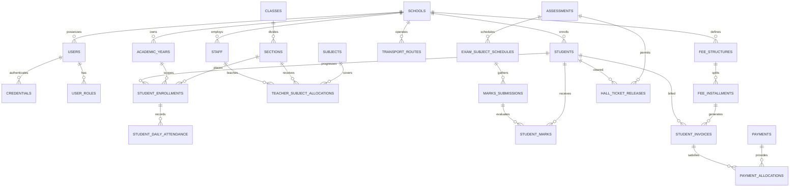

# Phase 11: FutureSchool Production Database & Multi-Tenant Architecture Specification

**Product:** FutureSchool — Commercial Multi-School Management SaaS Platform  
**Target Environment:** Java 21 LTS · Spring Boot 3.3.x · Spring Data JPA · PostgreSQL 16 · Flyway  
**Document Classification:** Architectural Blueprint & Schema Design (Phase 11)  
**Status:** Pre-Implementation Architectural Specification (No JPA entity code or Flyway migration executions in this phase)  

---

## 1. Database Architecture Overview

### 1.1 Multi-Tenant Topology
- **[DESIGN DECISION] Hybrid Shared-Database with Discriminator Column and Row-Level Security (RLS):**  
  FutureSchool will utilize a shared PostgreSQL 16 database instance where all tenant-owned tables enforce data isolation via a non-nullable `school_id UUID` column backed by PostgreSQL Row-Level Security (`ALTER TABLE ... ENABLE ROW LEVEL SECURITY`).
- **[DESIGN DECISION] Connection-Level Tenant Context Invariant:**  
  Every database connection retrieved from the HikariCP pool must have its session context established prior to query execution using `SET LOCAL app.current_school_id = '<UUID>';`. Direct queries lacking this session variable will evaluate to zero rows under PostgreSQL RLS default deny rules.
- **[DESIGN DECISION] Platform-Level Schema Separation:**  
  Platform Admin tables (`platform_users`, `schools`, `subscriptions`, `feature_entitlements`, `platform_audit_logs`) reside in the standard public or `platform` schema, completely excluded from tenant-scoped RLS policies. School administrators and portal users have zero database grants to query or join against the `platform` schema.
- **[IMPLEMENTATION TODO]** Configure `TenantAwareDataSource` in Spring Boot with a custom `ConnectionPreparer` and test connection cleanup guarantees under HikariCP connection reset policies.

---

## 2. Identifier Strategy

### 2.1 Primary Key Strategy vs Business Identifiers
- **[DESIGN DECISION] Time-Ordered UUIDv7 for Internal Primary Keys:**  
  All relational tables will use 128-bit `UUID` primary keys generated via UUIDv7 (or RFC 9562/PostgreSQL 16 `gen_random_uuid()` with timestamp prefix).  
  *Rationale:* UUIDv7 embeds a 48-bit UNIX millisecond timestamp at the high bits, preventing B-tree index fragmentation while eliminating sequential integer enumeration attacks across tenants.
- **[DESIGN DECISION] Strict Separation of Business Identifiers:**  
  Visible identifiers (Student ID, Admission Number, Invoice Number, Receipt Number, Complaint ID) must **never** serve as database primary keys. They are stored as secondary attributes subject to tenant-scoped uniqueness constraints.
- **[DESIGN DECISION] Human-Readable Identifier Schemas:**
  - **School Code:** `GVS`, `OAK`, `DPS` (3–8 uppercase alphanumeric chars, globally unique across platform).
  - **Student ID:** `GVS-2027-0001` (Format: `{SCHOOL_CODE}-{ENROLLMENT_YEAR}-{SEQUENCE:04d}`).
  - **Admission Number:** `ADM-2021-0842` (Statutory ledger number, format set per school policy).
  - **Staff ID:** `TCH0001`, `PRN0001`, `ADM0001` (Role prefix + sequential integer).
  - **Invoice Number:** `INV-2027-Q1-00042` (`INV-{YEAR}-{TERM}-{SEQUENCE}`).
  - **Receipt Number:** `FS-REC-2026-9042` (`FS-REC-{YEAR}-{RANDOM_OR_SEQUENCE}`).
  - **Payment Reference:** `PAY-STRIPE-ch_3N...` / `PAY-RZP-order_9...` (Gateway provider reference).
  - **Complaint Ticket:** `CMP-2027-0042` (`CMP-{YEAR}-{SEQUENCE:04d}`).
  - **Billing Run ID:** `BR-2027-Q1-GVS` (`BR-{YEAR}-{TERM}-{SCHOOL_CODE}`).
- **[DESIGN DECISION] Uniqueness Scopes:**
  - `school_code`: Globally unique across platform (`schools.code UNIQUE`).
  - `student_id`: Unique per tenant (`UNIQUE (school_id, student_id)`).
  - `staff_id`: Unique per tenant (`UNIQUE (school_id, staff_id)`).
  - `receipt_number`: Unique per tenant (`UNIQUE (school_id, receipt_number)`).
  - `provider_transaction_id`: Globally unique across system (`UNIQUE (provider, provider_tx_id)`).
- **[IMPLEMENTATION TODO]** Implement database sequence generators per tenant or deterministic formatters in Spring Boot application services with concurrency locks.

---

## 3. Tenant / School Model

```
platform_users
      ↓
   schools (Tenants)
      ↓
school_owned_records (students, staff, classes, invoices, etc.)
```

### 3.1 School Entity Design
- **[DESIGN DECISION] School Lifecycle States:**
  - `SETUP`: School provisioned; initial master configurations, academic calendar, and staff accounts being populated. Student/Parent logins disabled.
  - `ACTIVE`: Fully operational; all active students, parents, and staff have portal access within contracted subscription capacity.
  - `SUSPENDED`: Read-only lock due to non-payment or regulatory intervention. Staff and Students cannot log in; background billing paused.
  - `CLOSED`: Offboarded school. Access terminated; records archived under immutable statutory retention schedule.
- **[DESIGN DECISION] School Schema Definition:**
  ```sql
  CREATE TABLE schools (
      id UUID PRIMARY KEY DEFAULT gen_random_uuid(),
      code VARCHAR(16) NOT NULL UNIQUE,
      name VARCHAR(255) NOT NULL,
      legal_entity_name VARCHAR(255) NOT NULL,
      tagline VARCHAR(255),
      affiliation_number VARCHAR(128) NOT NULL,
      educational_board VARCHAR(32) NOT NULL, -- CBSE, ICSE, IB, CAMBRIDGE, STATE_BOARD
      status VARCHAR(32) NOT NULL DEFAULT 'SETUP', -- SETUP, ACTIVE, SUSPENDED, CLOSED
      subdomain VARCHAR(64) UNIQUE,
      custom_domain VARCHAR(255) UNIQUE,
      logo_file_asset_id UUID,
      primary_contact_name VARCHAR(128) NOT NULL,
      primary_contact_email VARCHAR(128) NOT NULL,
      primary_contact_phone VARCHAR(32) NOT NULL,
      address_street VARCHAR(255) NOT NULL,
      address_city VARCHAR(128) NOT NULL,
      address_state VARCHAR(128) NOT NULL,
      address_country VARCHAR(64) NOT NULL DEFAULT 'India',
      address_postal_code VARCHAR(16) NOT NULL,
      timezone VARCHAR(64) NOT NULL DEFAULT 'Asia/Kolkata',
      currency_code VARCHAR(8) NOT NULL DEFAULT 'INR',
      created_at TIMESTAMPTZ NOT NULL DEFAULT NOW(),
      updated_at TIMESTAMPTZ NOT NULL DEFAULT NOW(),
      version BIGINT NOT NULL DEFAULT 0
  );
  ```
- **[DESIGN DECISION] School ID Propagation:**  
  Every domain record created within the school scope carries `school_id UUID NOT NULL REFERENCES schools(id)`. Foreign keys between tenant-scoped tables must be compound `(school_id, id)` where parent tables are partitioned or referenced, ensuring no record can reference an entity belonging to a different tenant.
- **[IMPLEMENTATION TODO]** Create Flyway script `V1__init_schools.sql` and integrate RLS bypass role for platform superusers only.

---

## 4. Platform Admin Model

### 4.1 Boundary Enforcement
- **[DESIGN DECISION] Strict Role Isolation:**  
  Platform Admin accounts are stored in `platform_users`, distinct from school-level users in `users`.
  *Invariant:* A Platform Admin row has **no** `school_id`. They can inspect tenant metadata, change school states, and adjust subscription capacities, but have zero business access to classroom marks, student medical leave notes, or teacher personal grievances.
- **[DESIGN DECISION] Platform Tables:**
  - `platform_users`: Platform directors and infrastructure support engineers.
  - `platform_audit_logs`: Append-only security ledger tracking tenant activations, suspensions, and entitlement overrides.
  ```sql
  CREATE TABLE platform_users (
      id UUID PRIMARY KEY DEFAULT gen_random_uuid(),
      full_name VARCHAR(128) NOT NULL,
      email VARCHAR(128) NOT NULL UNIQUE,
      password_hash VARCHAR(255) NOT NULL,
      role VARCHAR(32) NOT NULL, -- PLATFORM_DIRECTOR, PLATFORM_SUPPORT, INFRA_ADMIN
      mfa_secret_encrypted VARCHAR(255),
      mfa_enabled BOOLEAN NOT NULL DEFAULT TRUE,
      status VARCHAR(32) NOT NULL DEFAULT 'ACTIVE',
      last_login_at TIMESTAMPTZ,
      created_at TIMESTAMPTZ NOT NULL DEFAULT NOW(),
      updated_at TIMESTAMPTZ NOT NULL DEFAULT NOW()
  );

  CREATE TABLE platform_audit_logs (
      id UUID PRIMARY KEY DEFAULT gen_random_uuid(),
      actor_platform_user_id UUID NOT NULL REFERENCES platform_users(id),
      target_school_id UUID REFERENCES schools(id),
      action VARCHAR(64) NOT NULL, -- SCHOOL_ONBOARDED, SCHOOL_ACTIVATED, SCHOOL_SUSPENDED, CAPACITY_EXPANDED
      entity_type VARCHAR(64) NOT NULL,
      entity_id VARCHAR(128) NOT NULL,
      changes JSONB,
      reason TEXT NOT NULL,
      network_ip VARCHAR(64) NOT NULL,
      created_at TIMESTAMPTZ NOT NULL DEFAULT NOW()
  );
  ```
- **[IMPLEMENTATION TODO]** Enforce Spring Security authority `ROLE_PLATFORM_ADMIN` with dedicated URL prefix `/api/v1/platform/**`, completely blocked from tenant school routes `/api/v1/schools/{schoolId}/**`.

---

## 5. Subscription Model

### 5.1 Commercial SaaS Pricing (B2B SaaS vs Student Tuition)
- **[DESIGN DECISION] Clear Separation of SaaS Invoicing vs School Tuition:**  
  `school_subscriptions` represents what the *School pays to FutureSchool* (e.g. ₹30–₹50 per billable student/month). This is totally segregated from what *Parents pay to the School* (`student_invoices`, `fee_structures`).
- **[DESIGN DECISION] Subscription Schema:**
  ```sql
  CREATE TABLE school_subscriptions (
      id UUID PRIMARY KEY DEFAULT gen_random_uuid(),
      school_id UUID NOT NULL REFERENCES schools(id) UNIQUE,
      plan_tier VARCHAR(32) NOT NULL, -- STARTER, STANDARD, PRO, ENTERPRISE
      billing_frequency VARCHAR(32) NOT NULL, -- MONTHLY, QUARTERLY, ANNUAL
      contracted_students INT NOT NULL,
      active_students INT NOT NULL DEFAULT 0,
      billable_students INT NOT NULL DEFAULT 0,
      price_per_student_per_month NUMERIC(10,2) NOT NULL,
      contract_start_date DATE NOT NULL,
      contract_end_date DATE NOT NULL,
      renewal_date DATE NOT NULL,
      status VARCHAR(32) NOT NULL DEFAULT 'ACTIVE', -- ACTIVE, OVERDUE, GRACE_PERIOD, EXPIRED
      created_at TIMESTAMPTZ NOT NULL DEFAULT NOW(),
      updated_at TIMESTAMPTZ NOT NULL DEFAULT NOW(),
      version BIGINT NOT NULL DEFAULT 0
  );

  CREATE TABLE school_feature_entitlements (
      id UUID PRIMARY KEY DEFAULT gen_random_uuid(),
      school_id UUID NOT NULL REFERENCES schools(id) UNIQUE,
      max_student_capacity INT NOT NULL,
      core_academics BOOLEAN NOT NULL DEFAULT TRUE,
      attendance_and_timetable BOOLEAN NOT NULL DEFAULT TRUE,
      homework_and_quizzes BOOLEAN NOT NULL DEFAULT TRUE,
      fees_and_invoicing BOOLEAN NOT NULL DEFAULT TRUE,
      fleet_transport BOOLEAN NOT NULL DEFAULT FALSE,
      ai_tutor_student BOOLEAN NOT NULL DEFAULT FALSE,
      ai_lesson_planner_teacher BOOLEAN NOT NULL DEFAULT FALSE,
      ai_executive_brief_principal BOOLEAN NOT NULL DEFAULT FALSE,
      sms_whatsapp_gateway BOOLEAN NOT NULL DEFAULT FALSE,
      custom_domain_ssl BOOLEAN NOT NULL DEFAULT FALSE,
      audit_retention_days INT NOT NULL DEFAULT 365,
      dedicated_account_manager BOOLEAN NOT NULL DEFAULT FALSE,
      updated_at TIMESTAMPTZ NOT NULL DEFAULT NOW()
  );
  ```
- **[DESIGN DECISION] Billable Student Reconciliation:**  
  `billable_students` is calculated via monthly billing runs taking the peak enrolled student count during the billing cycle, capped at minimum contracted seats.
- **[IMPLEMENTATION TODO]** Create automated monthly reconciliation cron job in Spring Boot to recalculate `billable_students` from active academic enrollments.

---

## 6. User / Identity Model

### 6.1 Shared Student / Parent Credential Context
- **[DESIGN DECISION] Distinct Identity vs Shared Credential Representation:**  
  Student and Parent authenticate using the Student ID (`GVS-2027-0001`), shared password, and registered guardian email, but must receive distinct security claims and portal contexts.
  *Architecture:*  
  1. A single row exists in `credentials` representing the family authentication principal.  
  2. The `credentials` record links to a `student` record and one or more `parents`.  
  3. When logging in, the user specifies the target `role` (`STUDENT` or `PARENT`).  
  4. Spring Security validates the credential, checks that the principal possesses the requested role, and issues a JWT with claims `sub: credentials_id`, `role: STUDENT|PARENT`, `school_id: UUID`, and `actor_id: student_id|parent_id`.
- **[DESIGN DECISION] Staff Accounts:**  
  Staff (Teacher, Principal, School Admin) have individual entries in `staff` and dedicated `credentials` with individual MFA secrets.
- **[DESIGN DECISION] Identity Schema:**
  ```sql
  CREATE TABLE users (
      id UUID PRIMARY KEY DEFAULT gen_random_uuid(),
      school_id UUID NOT NULL REFERENCES schools(id),
      user_type VARCHAR(32) NOT NULL, -- STUDENT_FAMILY, STAFF
      primary_email VARCHAR(128) NOT NULL,
      primary_phone VARCHAR(32),
      status VARCHAR(32) NOT NULL DEFAULT 'ACTIVE', -- ACTIVE, LOCKED, SUSPENDED, EXITED
      failed_login_attempts INT NOT NULL DEFAULT 0,
      locked_until TIMESTAMPTZ,
      created_at TIMESTAMPTZ NOT NULL DEFAULT NOW(),
      updated_at TIMESTAMPTZ NOT NULL DEFAULT NOW()
  );

  CREATE TABLE credentials (
      id UUID PRIMARY KEY DEFAULT gen_random_uuid(),
      user_id UUID NOT NULL REFERENCES users(id) ON DELETE CASCADE,
      school_id UUID NOT NULL REFERENCES schools(id),
      identifier VARCHAR(64) NOT NULL, -- GVS-2027-0001 or TCH0001 or ADM0001
      password_hash VARCHAR(255) NOT NULL, -- Argon2id or BCrypt strength 12
      password_salt VARCHAR(64),
      password_changed_at TIMESTAMPTZ NOT NULL DEFAULT NOW(),
      must_change_password BOOLEAN NOT NULL DEFAULT FALSE,
      mfa_secret_encrypted VARCHAR(255),
      mfa_enabled BOOLEAN NOT NULL DEFAULT FALSE,
      mfa_recovery_codes_hash JSONB,
      CONSTRAINT uq_tenant_identifier UNIQUE (school_id, identifier)
  );

  CREATE TABLE user_roles (
      id UUID PRIMARY KEY DEFAULT gen_random_uuid(),
      user_id UUID NOT NULL REFERENCES users(id) ON DELETE CASCADE,
      school_id UUID NOT NULL REFERENCES schools(id),
      role_name VARCHAR(32) NOT NULL, -- STUDENT, PARENT, TEACHER, PRINCIPAL, ADMIN
      assigned_at TIMESTAMPTZ NOT NULL DEFAULT NOW(),
      CONSTRAINT uq_user_role UNIQUE (user_id, role_name)
  );

  CREATE TABLE admin_permissions (
      id UUID PRIMARY KEY DEFAULT gen_random_uuid(),
      user_id UUID NOT NULL REFERENCES users(id) ON DELETE CASCADE,
      school_id UUID NOT NULL REFERENCES schools(id),
      permission VARCHAR(64) NOT NULL, -- ADMISSIONS, FINANCE, ACADEMIC_OPERATIONS, TRANSPORT, SECURITY, REPORTS
      granted_by UUID NOT NULL REFERENCES users(id),
      granted_at TIMESTAMPTZ NOT NULL DEFAULT NOW(),
      CONSTRAINT uq_admin_permission UNIQUE (user_id, permission)
  );
  ```
- **[IMPLEMENTATION TODO]** Secure storage of TOTP MFA secrets using AES-256-GCM envelope encryption where key is injected via KMS/Vault environment variable.

---

## 7. Student Identity vs Academic Enrollment

### 7.1 Permanent Identity vs Year-Specific Placement
- **[DESIGN DECISION] Separation of Student Master from Academic Year Enrollment:**  
  A student's core identity (`students`) is immutable across their entire tenure at the institution (retains permanent Student ID, bio, blood group, admission date).  
  Class, section, roll number, class mentor, and academic standing reside in `student_enrollments`, scoped strictly by `academic_year_id`.
- **[DESIGN DECISION] Student Master & Enrollment Schema:**
  ```sql
  CREATE TABLE students (
      id UUID PRIMARY KEY DEFAULT gen_random_uuid(),
      school_id UUID NOT NULL REFERENCES schools(id),
      user_id UUID NOT NULL REFERENCES users(id),
      student_id VARCHAR(32) NOT NULL, -- e.g. GVS-2027-0001
      admission_number VARCHAR(64) NOT NULL, -- e.g. ADM-2021-0842
      first_name VARCHAR(64) NOT NULL,
      last_name VARCHAR(64) NOT NULL,
      date_of_birth DATE NOT NULL,
      gender VARCHAR(16) NOT NULL,
      blood_group VARCHAR(8),
      admission_date DATE NOT NULL,
      emergency_contact_phone VARCHAR(32) NOT NULL,
      medical_notes TEXT,
      status VARCHAR(32) NOT NULL DEFAULT 'ACTIVE', -- ACTIVE, TRANSFERRED, ALUMNI, EXITED
      created_at TIMESTAMPTZ NOT NULL DEFAULT NOW(),
      updated_at TIMESTAMPTZ NOT NULL DEFAULT NOW(),
      CONSTRAINT uq_tenant_student_id UNIQUE (school_id, student_id),
      CONSTRAINT uq_tenant_admission_no UNIQUE (school_id, admission_number)
  );

  CREATE TABLE student_enrollments (
      id UUID PRIMARY KEY DEFAULT gen_random_uuid(),
      school_id UUID NOT NULL REFERENCES schools(id),
      student_id UUID NOT NULL REFERENCES students(id),
      academic_year_id UUID NOT NULL REFERENCES academic_years(id),
      class_id UUID NOT NULL REFERENCES classes(id),
      section_id UUID NOT NULL REFERENCES sections(id),
      roll_number INT NOT NULL,
      enrollment_date DATE NOT NULL,
      enrollment_status VARCHAR(32) NOT NULL DEFAULT 'ENROLLED', -- ENROLLED, PROMOTED, DETAINED, REPEAT, WITHDRAWN
      created_at TIMESTAMPTZ NOT NULL DEFAULT NOW(),
      updated_at TIMESTAMPTZ NOT NULL DEFAULT NOW(),
      CONSTRAINT uq_tenant_year_student UNIQUE (school_id, academic_year_id, student_id),
      CONSTRAINT uq_tenant_section_roll UNIQUE (school_id, academic_year_id, section_id, roll_number)
  );
  ```
- **[IMPLEMENTATION TODO]** Create database triggers or services ensuring `roll_number` is unique within `(academic_year_id, section_id)`.

---

## 8. Family Relationship Model

### 8.1 Administrative Kinship Tracking
- **[DESIGN DECISION] Internal Family Entity for Concessions & Verification:**  
  Siblings are linked to a shared `families` entity via `family_student_relationships`. This allows the Finance Desk to automatically detect and validate sibling discounts (e.g. 10% waiver on second child), without granting either parent cross-ward dashboard permissions.
- **[DESIGN DECISION] Family Schema:**
  ```sql
  CREATE TABLE families (
      id UUID PRIMARY KEY DEFAULT gen_random_uuid(),
      school_id UUID NOT NULL REFERENCES schools(id),
      family_code VARCHAR(32) NOT NULL, -- e.g. FAM-00492
      father_name VARCHAR(128),
      mother_name VARCHAR(128),
      guardian_name VARCHAR(128),
      primary_email VARCHAR(128) NOT NULL,
      primary_phone VARCHAR(32) NOT NULL,
      residential_address TEXT NOT NULL,
      sibling_discount_eligible BOOLEAN NOT NULL DEFAULT FALSE,
      created_at TIMESTAMPTZ NOT NULL DEFAULT NOW(),
      CONSTRAINT uq_tenant_family_code UNIQUE (school_id, family_code)
  );

  CREATE TABLE family_student_relationships (
      id UUID PRIMARY KEY DEFAULT gen_random_uuid(),
      school_id UUID NOT NULL REFERENCES schools(id),
      family_id UUID NOT NULL REFERENCES families(id),
      student_id UUID NOT NULL REFERENCES students(id),
      relationship_type VARCHAR(32) NOT NULL, -- FATHER, MOTHER, LEGAL_GUARDIAN
      is_primary_contact BOOLEAN NOT NULL DEFAULT FALSE,
      created_at TIMESTAMPTZ NOT NULL DEFAULT NOW(),
      CONSTRAINT uq_family_student UNIQUE (family_id, student_id)
  );
  ```
- **[IMPLEMENTATION TODO]** Create index on `(school_id, primary_phone)` and `(school_id, primary_email)` to detect incoming sibling admissions during the Admissions Wizard flow.

---

## 9. Staff Model

### 9.1 Separation of Employment Identity from Academic Assignments
- **[DESIGN DECISION] Staff Employment Master:**  
  A teacher's employment contract, qualifications, and system identity are modeled in `staff` and `staff_employment`. Their teaching roles (Subject Teacher allocations, Class Mentor assignments, Exam Duty, and Substitution Coverage) are distinct records linked via foreign keys.
- **[DESIGN DECISION] Historical Ownership Guarantee:**  
  When a teacher leaves the institution or is reassigned, marks sheets and report card remarks previously submitted by that teacher must permanently retain their reference (`submitted_by_staff_id`).
- **[DESIGN DECISION] Staff Schema:**
  ```sql
  CREATE TABLE staff (
      id UUID PRIMARY KEY DEFAULT gen_random_uuid(),
      school_id UUID NOT NULL REFERENCES schools(id),
      user_id UUID NOT NULL REFERENCES users(id),
      staff_id VARCHAR(32) NOT NULL, -- e.g. TCH0001, PRN0001, ADM0001
      first_name VARCHAR(64) NOT NULL,
      last_name VARCHAR(64) NOT NULL,
      designation VARCHAR(64) NOT NULL, -- Senior PGT, TGT, Principal, Bursar
      department VARCHAR(64) NOT NULL, -- Mathematics, Science, Administration
      date_of_joining DATE NOT NULL,
      employment_status VARCHAR(32) NOT NULL DEFAULT 'ACTIVE', -- ACTIVE, ON_LEAVE, RESIGNED, RETIRED
      primary_phone VARCHAR(32) NOT NULL,
      created_at TIMESTAMPTZ NOT NULL DEFAULT NOW(),
      updated_at TIMESTAMPTZ NOT NULL DEFAULT NOW(),
      CONSTRAINT uq_tenant_staff_id UNIQUE (school_id, staff_id)
  );

  CREATE TABLE staff_leaves (
      id UUID PRIMARY KEY DEFAULT gen_random_uuid(),
      school_id UUID NOT NULL REFERENCES schools(id),
      staff_id UUID NOT NULL REFERENCES staff(id),
      leave_type VARCHAR(32) NOT NULL, -- CASUAL, MEDICAL, SYMPOSIUM, DUTY
      start_date DATE NOT NULL,
      end_date DATE NOT NULL,
      reason TEXT NOT NULL,
      substitute_staff_id UUID REFERENCES staff(id),
      status VARCHAR(32) NOT NULL DEFAULT 'PENDING', -- PENDING, APPROVED, REJECTED
      approved_by_staff_id UUID REFERENCES staff(id),
      approval_comment TEXT,
      created_at TIMESTAMPTZ NOT NULL DEFAULT NOW()
  );

  CREATE TABLE staff_temporary_coverage (
      id UUID PRIMARY KEY DEFAULT gen_random_uuid(),
      school_id UUID NOT NULL REFERENCES schools(id),
      timetable_period_id UUID NOT NULL REFERENCES timetable_periods(id),
      coverage_date DATE NOT NULL,
      absent_staff_id UUID NOT NULL REFERENCES staff(id),
      assigned_substitute_staff_id UUID NOT NULL REFERENCES staff(id),
      reason VARCHAR(255) NOT NULL,
      status VARCHAR(32) NOT NULL DEFAULT 'ASSIGNED', -- ASSIGNED, COMPLETED, CANCELLED
      created_at TIMESTAMPTZ NOT NULL DEFAULT NOW()
  );
  ```
- **[IMPLEMENTATION TODO]** Create conflict validation query ensuring substitute teacher does not already have an assigned class in the target period on `coverage_date`.

---

## 10. Academic Structure

### 10.1 Hierarchy & Versioning
- **[DESIGN DECISION] Academic Hierarchy:**  
  `academic_years` $\rightarrow$ `classes` (e.g. Grade 10) $\rightarrow$ `sections` (e.g. Section A) $\rightarrow$ `class_subjects` (e.g. Grade 10-A Mathematics).
- **[DESIGN DECISION] Academic Structure Schema:**
  ```sql
  CREATE TABLE academic_years (
      id UUID PRIMARY KEY DEFAULT gen_random_uuid(),
      school_id UUID NOT NULL REFERENCES schools(id),
      name VARCHAR(32) NOT NULL, -- e.g. "2026-2027"
      start_date DATE NOT NULL,
      end_date DATE NOT NULL,
      is_current BOOLEAN NOT NULL DEFAULT FALSE,
      status VARCHAR(32) NOT NULL DEFAULT 'UPCOMING', -- UPCOMING, ACTIVE, CLOSED, ARCHIVED
      created_at TIMESTAMPTZ NOT NULL DEFAULT NOW(),
      CONSTRAINT uq_tenant_academic_year UNIQUE (school_id, name)
  );

  CREATE TABLE classes (
      id UUID PRIMARY KEY DEFAULT gen_random_uuid(),
      school_id UUID NOT NULL REFERENCES schools(id),
      academic_year_id UUID NOT NULL REFERENCES academic_years(id),
      name VARCHAR(32) NOT NULL, -- e.g. "Grade 10"
      stage VARCHAR(32) NOT NULL, -- PRIMARY, MIDDLE, SECONDARY, SENIOR_SECONDARY
      sequence_order INT NOT NULL,
      created_at TIMESTAMPTZ NOT NULL DEFAULT NOW(),
      CONSTRAINT uq_tenant_class UNIQUE (school_id, academic_year_id, name)
  );

  CREATE TABLE sections (
      id UUID PRIMARY KEY DEFAULT gen_random_uuid(),
      school_id UUID NOT NULL REFERENCES schools(id),
      class_id UUID NOT NULL REFERENCES classes(id),
      name VARCHAR(16) NOT NULL, -- e.g. "A", "B"
      capacity_limit INT NOT NULL DEFAULT 40,
      room_number VARCHAR(32) NOT NULL,
      created_at TIMESTAMPTZ NOT NULL DEFAULT NOW(),
      CONSTRAINT uq_class_section UNIQUE (class_id, name)
  );

  CREATE TABLE subjects (
      id UUID PRIMARY KEY DEFAULT gen_random_uuid(),
      school_id UUID NOT NULL REFERENCES schools(id),
      code VARCHAR(32) NOT NULL, -- e.g. "MATH-10"
      name VARCHAR(128) NOT NULL, -- e.g. "Mathematics"
      subject_type VARCHAR(32) NOT NULL DEFAULT 'THEORY', -- THEORY, PRACTICAL, HYBRID
      created_at TIMESTAMPTZ NOT NULL DEFAULT NOW(),
      CONSTRAINT uq_tenant_subject_code UNIQUE (school_id, code)
  );

  CREATE TABLE teacher_subject_allocations (
      id UUID PRIMARY KEY DEFAULT gen_random_uuid(),
      school_id UUID NOT NULL REFERENCES schools(id),
      academic_year_id UUID NOT NULL REFERENCES academic_years(id),
      section_id UUID NOT NULL REFERENCES sections(id),
      subject_id UUID NOT NULL REFERENCES subjects(id),
      staff_id UUID NOT NULL REFERENCES staff(id),
      is_primary BOOLEAN NOT NULL DEFAULT TRUE,
      created_at TIMESTAMPTZ NOT NULL DEFAULT NOW(),
      CONSTRAINT uq_section_subject_staff UNIQUE (section_id, subject_id, staff_id)
  );

  CREATE TABLE class_teacher_assignments (
      id UUID PRIMARY KEY DEFAULT gen_random_uuid(),
      school_id UUID NOT NULL REFERENCES schools(id),
      academic_year_id UUID NOT NULL REFERENCES academic_years(id),
      section_id UUID NOT NULL REFERENCES sections(id),
      staff_id UUID NOT NULL REFERENCES staff(id),
      effective_start_date DATE NOT NULL,
      effective_end_date DATE,
      is_active BOOLEAN NOT NULL DEFAULT TRUE,
      created_at TIMESTAMPTZ NOT NULL DEFAULT NOW(),
      CONSTRAINT uq_active_class_teacher UNIQUE (academic_year_id, section_id, is_active)
  );
  ```
- **[IMPLEMENTATION TODO]** Flyway migration for timetable master versions (`timetable_versions`, `timetable_periods`).

---

## 11. Student Attendance

### 11.1 Morning / Afternoon Roll Call with Derived Daily Rollup
- **[DESIGN DECISION] Session-Level Attendance with Daily State Derivation:**  
  Roll call is marked per session (`MORNING` and `AFTERNOON`) to handle half-day departures or authorized doctor appointments.  
  Daily derived status:  
  - Morning PRESENT + Afternoon PRESENT $\rightarrow$ `FULL_DAY_PRESENT`  
  - Morning PRESENT + Afternoon ABSENT $\rightarrow$ `HALF_DAY_ABSENT`  
  - Both ABSENT without sanctioned leave $\rightarrow$ `FULL_DAY_ABSENT`  
  - Both covered by sanctioned leave $\rightarrow$ `SANCTIONED_LEAVE`
- **[DESIGN DECISION] Correction History:**  
  Attendance records are never overwritten silently. Modifying an existing record writes to `attendance_corrections` recording previous status, new status, correcting teacher, and reason.
- **[DESIGN DECISION] Attendance Schema:**
  ```sql
  CREATE TABLE student_daily_attendance (
      id UUID PRIMARY KEY DEFAULT gen_random_uuid(),
      school_id UUID NOT NULL REFERENCES schools(id),
      student_id UUID NOT NULL REFERENCES students(id),
      section_id UUID NOT NULL REFERENCES sections(id),
      attendance_date DATE NOT NULL,
      morning_status VARCHAR(16) NOT NULL, -- PRESENT, ABSENT, LATE, LEAVE
      afternoon_status VARCHAR(16) NOT NULL, -- PRESENT, ABSENT, LATE, LEAVE
      daily_derived_status VARCHAR(32) NOT NULL, -- FULL_DAY_PRESENT, HALF_DAY, FULL_DAY_ABSENT, SANCTIONED_LEAVE
      approved_leave_request_id UUID,
      marked_by_staff_id UUID NOT NULL REFERENCES staff(id),
      created_at TIMESTAMPTZ NOT NULL DEFAULT NOW(),
      updated_at TIMESTAMPTZ NOT NULL DEFAULT NOW(),
      CONSTRAINT uq_student_attendance_date UNIQUE (school_id, student_id, attendance_date)
  );

  CREATE TABLE student_attendance_corrections (
      id UUID PRIMARY KEY DEFAULT gen_random_uuid(),
      school_id UUID NOT NULL REFERENCES schools(id),
      attendance_id UUID NOT NULL REFERENCES student_daily_attendance(id),
      previous_status VARCHAR(32) NOT NULL,
      corrected_status VARCHAR(32) NOT NULL,
      correction_reason TEXT NOT NULL,
      corrected_by_staff_id UUID NOT NULL REFERENCES staff(id),
      created_at TIMESTAMPTZ NOT NULL DEFAULT NOW()
  );
  ```
- **[IMPLEMENTATION TODO]** Create database view `v_student_attendance_summary` aggregating attendance percentage per student for hall ticket gate verification.

---

## 12. Homework

- **[DESIGN DECISION] Homework Workflow & File Decoupling:**  
  Homework tasks are authored by subject teachers, scoped to sections, and versioned. Student submissions store text and object-storage asset references (`file_assets`), with homework evaluation strictly isolated from formal examination marks.
- **[DESIGN DECISION] Homework Schema:**
  ```sql
  CREATE TABLE homework (
      id UUID PRIMARY KEY DEFAULT gen_random_uuid(),
      school_id UUID NOT NULL REFERENCES schools(id),
      section_id UUID NOT NULL REFERENCES sections(id),
      subject_id UUID NOT NULL REFERENCES subjects(id),
      assigned_by_staff_id UUID NOT NULL REFERENCES staff(id),
      title VARCHAR(255) NOT NULL,
      description TEXT NOT NULL,
      submission_type VARCHAR(32) NOT NULL DEFAULT 'TEXT_AND_FILE', -- ONLINE_TEXT, FILE_UPLOAD, OFFLINE
      due_date TIMESTAMPTZ NOT NULL,
      status VARCHAR(32) NOT NULL DEFAULT 'DRAFT', -- DRAFT, PUBLISHED, ARCHIVED
      max_score INT,
      created_at TIMESTAMPTZ NOT NULL DEFAULT NOW(),
      updated_at TIMESTAMPTZ NOT NULL DEFAULT NOW()
  );

  CREATE TABLE homework_submissions (
      id UUID PRIMARY KEY DEFAULT gen_random_uuid(),
      school_id UUID NOT NULL REFERENCES schools(id),
      homework_id UUID NOT NULL REFERENCES homework(id),
      student_id UUID NOT NULL REFERENCES students(id),
      submission_text TEXT,
      submitted_at TIMESTAMPTZ NOT NULL DEFAULT NOW(),
      is_late BOOLEAN NOT NULL DEFAULT FALSE,
      status VARCHAR(32) NOT NULL DEFAULT 'SUBMITTED', -- SUBMITTED, REVIEWED, RESUBMISSION_REQUIRED
      score_awarded INT,
      teacher_feedback TEXT,
      reviewed_by_staff_id UUID REFERENCES staff(id),
      reviewed_at TIMESTAMPTZ,
      CONSTRAINT uq_homework_student_submission UNIQUE (homework_id, student_id)
  );
  ```
- **[IMPLEMENTATION TODO]** Enforce RLS allowing students to query only their own `homework_submissions` rows.

---

## 13. Quiz and Question Bank

- **[DESIGN DECISION] Question Bank Reuse & Assessment Isolation:**  
  `question_banks` contain tagged MCQ/short-answer questions. `quizzes` assemble selected question instances, set attempt limits and deadlines. Student attempts record answers in `quiz_attempts` and `quiz_attempt_answers`.
- **[DESIGN DECISION] Quiz Schema:**
  ```sql
  CREATE TABLE question_banks (
      id UUID PRIMARY KEY DEFAULT gen_random_uuid(),
      school_id UUID NOT NULL REFERENCES schools(id),
      subject_id UUID NOT NULL REFERENCES subjects(id),
      chapter VARCHAR(128) NOT NULL,
      topic VARCHAR(128),
      question_text TEXT NOT NULL,
      question_type VARCHAR(32) NOT NULL DEFAULT 'MCQ',
      difficulty VARCHAR(16) NOT NULL DEFAULT 'MEDIUM', -- EASY, MEDIUM, HARD
      options_json JSONB NOT NULL, -- Array of { id, text, isCorrect }
      explanation TEXT,
      created_by_staff_id UUID NOT NULL REFERENCES staff(id),
      created_at TIMESTAMPTZ NOT NULL DEFAULT NOW()
  );

  CREATE TABLE quizzes (
      id UUID PRIMARY KEY DEFAULT gen_random_uuid(),
      school_id UUID NOT NULL REFERENCES schools(id),
      section_id UUID NOT NULL REFERENCES sections(id),
      subject_id UUID NOT NULL REFERENCES subjects(id),
      title VARCHAR(255) NOT NULL,
      duration_minutes INT NOT NULL DEFAULT 30,
      total_marks INT NOT NULL,
      max_attempts INT NOT NULL DEFAULT 1,
      available_from TIMESTAMPTZ NOT NULL,
      due_date TIMESTAMPTZ NOT NULL,
      status VARCHAR(32) NOT NULL DEFAULT 'DRAFT',
      created_by_staff_id UUID NOT NULL REFERENCES staff(id),
      created_at TIMESTAMPTZ NOT NULL DEFAULT NOW()
  );

  CREATE TABLE quiz_attempts (
      id UUID PRIMARY KEY DEFAULT gen_random_uuid(),
      school_id UUID NOT NULL REFERENCES schools(id),
      quiz_id UUID NOT NULL REFERENCES quizzes(id),
      student_id UUID NOT NULL REFERENCES students(id),
      attempt_number INT NOT NULL,
      started_at TIMESTAMPTZ NOT NULL DEFAULT NOW(),
      submitted_at TIMESTAMPTZ,
      score_obtained INT NOT NULL DEFAULT 0,
      status VARCHAR(32) NOT NULL DEFAULT 'IN_PROGRESS', -- IN_PROGRESS, COMPLETED, ABANDONED
      CONSTRAINT uq_quiz_student_attempt UNIQUE (quiz_id, student_id, attempt_number)
  );
  ```
- **[IMPLEMENTATION TODO]** Create API preventing students from viewing `options_json.isCorrect` before quiz attempt submission.

---

## 14. Study Materials & File Decoupling

- **[DESIGN DECISION] Object Storage Pointer Model:**  
  Large binary assets (PDFs, PPTs, exam blueprints) are never stored in PostgreSQL. The database stores strictly file metadata (`file_assets`) with storage keys (e.g. `s3://futureschool-tenants/gvs/materials/mat_0921.pdf`).
- **[DESIGN DECISION] AI Approval Versioning:**  
  Uploading a new revision of a study material creates a new `material_version` row with `ai_curriculum_approved = FALSE`. Approval is never silently inherited from previous versions.
- **[DESIGN DECISION] Study Material Schema:**
  ```sql
  CREATE TABLE study_materials (
      id UUID PRIMARY KEY DEFAULT gen_random_uuid(),
      school_id UUID NOT NULL REFERENCES schools(id),
      subject_id UUID NOT NULL REFERENCES subjects(id),
      title VARCHAR(255) NOT NULL,
      description TEXT,
      class_id UUID NOT NULL REFERENCES classes(id),
      current_version INT NOT NULL DEFAULT 1,
      status VARCHAR(32) NOT NULL DEFAULT 'PUBLISHED',
      uploaded_by_staff_id UUID NOT NULL REFERENCES staff(id),
      created_at TIMESTAMPTZ NOT NULL DEFAULT NOW()
  );

  CREATE TABLE study_material_versions (
      id UUID PRIMARY KEY DEFAULT gen_random_uuid(),
      school_id UUID NOT NULL REFERENCES schools(id),
      material_id UUID NOT NULL REFERENCES study_materials(id) ON DELETE CASCADE,
      version_number INT NOT NULL,
      file_asset_id UUID NOT NULL REFERENCES file_assets(id),
      ai_curriculum_approved BOOLEAN NOT NULL DEFAULT FALSE,
      ai_approved_at TIMESTAMPTZ,
      ai_approved_by_staff_id UUID REFERENCES staff(id),
      created_at TIMESTAMPTZ NOT NULL DEFAULT NOW(),
      CONSTRAINT uq_material_version UNIQUE (material_id, version_number)
  );
  ```
- **[IMPLEMENTATION TODO]** Implement AWS S3 / Google Cloud Storage presigned URL generator in Spring Boot.

---

## 15. Examination Structure

### 15.1 Configuration vs Dynamic Schedules
- **[DESIGN DECISION] Decouple Assessment Configuration from Examination Schedule:**  
  `assessments` defines the term assessment (e.g. "Term 1 Mid-Year Examination 2027", max marks, weightage). `exam_schedules` maps specific date, room, invigilator, and marks entry deadlines.
- **[DESIGN DECISION] Exam Schema:**
  ```sql
  CREATE TABLE assessments (
      id UUID PRIMARY KEY DEFAULT gen_random_uuid(),
      school_id UUID NOT NULL REFERENCES schools(id),
      academic_year_id UUID NOT NULL REFERENCES academic_years(id),
      name VARCHAR(128) NOT NULL, -- e.g. "Term 1 Mid-Year Examination"
      assessment_type VARCHAR(32) NOT NULL, -- FORMATIVE, SUMMATIVE, PRE_BOARD, ANNUAL
      weightage_percentage DECIMAL(5,2) NOT NULL DEFAULT 20.0,
      status VARCHAR(32) NOT NULL DEFAULT 'DRAFT', -- DRAFT, SCHEDULED, ACTIVE, CONCLUDED
      created_at TIMESTAMPTZ NOT NULL DEFAULT NOW()
  );

  CREATE TABLE exam_subject_schedules (
      id UUID PRIMARY KEY DEFAULT gen_random_uuid(),
      school_id UUID NOT NULL REFERENCES schools(id),
      assessment_id UUID NOT NULL REFERENCES assessments(id),
      class_id UUID NOT NULL REFERENCES classes(id),
      subject_id UUID NOT NULL REFERENCES subjects(id),
      exam_date DATE NOT NULL,
      start_time TIME NOT NULL,
      end_time TIME NOT NULL,
      max_marks DECIMAL(5,2) NOT NULL DEFAULT 100.0,
      pass_marks DECIMAL(5,2) NOT NULL DEFAULT 35.0,
      marks_entry_deadline TIMESTAMPTZ NOT NULL,
      created_at TIMESTAMPTZ NOT NULL DEFAULT NOW(),
      CONSTRAINT uq_assessment_class_subject UNIQUE (assessment_id, class_id, subject_id)
  );
  ```
- **[IMPLEMENTATION TODO]** Create trigger preventing marks entry after `marks_entry_deadline` unless an explicit marks-reopening waiver exists.

---

## 16. Marks & Moderation Pipeline

### 16.1 Critical Invariant: 0 Marks vs Absent (AB)
- **[DESIGN DECISION] Explicit Attendance Flag in Marks Recording:**  
  A mark score of `0` is mathematically and legally distinct from `is_absent = TRUE` (`AB`).  
  *Schema rule:* When `attendance_status = 'ABSENT'`, `score` must evaluate to `NULL` or `0` with `attendance_status = 'ABSENT'` stored explicitly.
- **[DESIGN DECISION] Marks Pipeline Workflow:**  
  `DRAFT` (Teacher editing) $\rightarrow$ `SUBMITTED` (Pending Principal review) $\rightarrow$ `RETURNED` (Principal requested corrections) $\rightarrow$ `ACCEPTED` (Principal endorsed).
- **[DESIGN DECISION] Marks Schema:**
  ```sql
  CREATE TABLE marks_submissions (
      id UUID PRIMARY KEY DEFAULT gen_random_uuid(),
      school_id UUID NOT NULL REFERENCES schools(id),
      exam_schedule_id UUID NOT NULL REFERENCES exam_subject_schedules(id),
      section_id UUID NOT NULL REFERENCES sections(id),
      submitted_by_staff_id UUID NOT NULL REFERENCES staff(id),
      status VARCHAR(32) NOT NULL DEFAULT 'DRAFT', -- DRAFT, SUBMITTED, RETURNED, ACCEPTED
      return_reason TEXT,
      reviewed_by_staff_id UUID REFERENCES staff(id),
      reviewed_at TIMESTAMPTZ,
      version INT NOT NULL DEFAULT 1,
      created_at TIMESTAMPTZ NOT NULL DEFAULT NOW(),
      updated_at TIMESTAMPTZ NOT NULL DEFAULT NOW(),
      CONSTRAINT uq_exam_section_submission UNIQUE (exam_schedule_id, section_id)
  );

  CREATE TABLE student_marks (
      id UUID PRIMARY KEY DEFAULT gen_random_uuid(),
      school_id UUID NOT NULL REFERENCES schools(id),
      submission_id UUID NOT NULL REFERENCES marks_submissions(id) ON DELETE CASCADE,
      student_id UUID NOT NULL REFERENCES students(id),
      attendance_status VARCHAR(16) NOT NULL DEFAULT 'ATTENDED', -- ATTENDED, ABSENT, MEDICAL_RE_EXAM
      score DECIMAL(5,2),
      max_score DECIMAL(5,2) NOT NULL,
      grade VARCHAR(8),
      moderation_adjustment DECIMAL(5,2) DEFAULT 0.0,
      teacher_remarks VARCHAR(255),
      created_at TIMESTAMPTZ NOT NULL DEFAULT NOW(),
      updated_at TIMESTAMPTZ NOT NULL DEFAULT NOW(),
      CONSTRAINT chk_score_within_range CHECK (score IS NULL OR (score >= 0 AND score <= max_score)),
      CONSTRAINT uq_submission_student_mark UNIQUE (submission_id, student_id)
  );

  CREATE TABLE marks_corrections_log (
      id UUID PRIMARY KEY DEFAULT gen_random_uuid(),
      school_id UUID NOT NULL REFERENCES schools(id),
      student_mark_id UUID NOT NULL REFERENCES student_marks(id),
      previous_score DECIMAL(5,2),
      new_score DECIMAL(5,2),
      reason TEXT NOT NULL,
      authorized_by_principal_id UUID NOT NULL REFERENCES staff(id),
      created_at TIMESTAMPTZ NOT NULL DEFAULT NOW()
  );
  ```
- **[IMPLEMENTATION TODO]** Create automated grade calculator function (`score / max_score * 100`) mapping to CBSE/IB scale (A1, A2, B1, etc.).

---

## 17. Report Cards & Publication

- **[DESIGN DECISION] Immutable Published Cards with Versioning:**  
  Class teacher generates report cards; Principal reviews and digitally endorses (`principal_signature = TRUE`); Class teacher releases class-wide.  
  Once published to parents, a report card is **never silently updated in place**. Any correction requires issuing an incremented version (e.g. `v1.1`), logging the administrative correction memo.
- **[DESIGN DECISION] Report Card Schema:**
  ```sql
  CREATE TABLE report_cards (
      id UUID PRIMARY KEY DEFAULT gen_random_uuid(),
      school_id UUID NOT NULL REFERENCES schools(id),
      student_id UUID NOT NULL REFERENCES students(id),
      assessment_id UUID NOT NULL REFERENCES assessments(id),
      academic_year_id UUID NOT NULL REFERENCES academic_years(id),
      version INT NOT NULL DEFAULT 1,
      overall_percentage DECIMAL(5,2) NOT NULL,
      overall_grade VARCHAR(8) NOT NULL,
      attendance_percentage DECIMAL(5,2) NOT NULL,
      conduct_remarks TEXT NOT NULL,
      class_teacher_staff_id UUID NOT NULL REFERENCES staff(id),
      principal_signature BOOLEAN NOT NULL DEFAULT FALSE,
      principal_signed_at TIMESTAMPTZ,
      status VARCHAR(32) NOT NULL DEFAULT 'DRAFT', -- DRAFT, PENDING_PRINCIPAL, APPROVED, PUBLISHED
      is_published_to_parent BOOLEAN NOT NULL DEFAULT FALSE,
      published_at TIMESTAMPTZ,
      pdf_file_asset_id UUID REFERENCES file_assets(id),
      parent_acknowledged BOOLEAN NOT NULL DEFAULT FALSE,
      parent_acknowledged_at TIMESTAMPTZ,
      created_at TIMESTAMPTZ NOT NULL DEFAULT NOW(),
      updated_at TIMESTAMPTZ NOT NULL DEFAULT NOW(),
      CONSTRAINT uq_student_assessment_version UNIQUE (student_id, assessment_id, version)
  );
  ```
- **[IMPLEMENTATION TODO]** Write iText / JasperReports PDF generator job storing generated cards in `file_assets`.

---

## 18. Student Promotion

- **[DESIGN DECISION] Non-Destructive Progression:**  
  Promoting a student creates a brand new `student_enrollments` record for the upcoming academic year. The past enrollment remains untouched with status `PROMOTED`.
- **[DESIGN DECISION] Promotion Schema:**
  ```sql
  CREATE TABLE promotion_records (
      id UUID PRIMARY KEY DEFAULT gen_random_uuid(),
      school_id UUID NOT NULL REFERENCES schools(id),
      student_id UUID NOT NULL REFERENCES students(id),
      from_academic_year_id UUID NOT NULL REFERENCES academic_years(id),
      to_academic_year_id UUID NOT NULL REFERENCES academic_years(id),
      from_section_id UUID NOT NULL REFERENCES sections(id),
      to_section_id UUID NOT NULL REFERENCES sections(id),
      teacher_recommendation VARCHAR(32) NOT NULL, -- PROMOTE, RETAIN, CONDITIONAL
      principal_decision VARCHAR(32) NOT NULL, -- APPROVED, OVERRULED
      executed_by_admin_id UUID NOT NULL REFERENCES staff(id),
      execution_timestamp TIMESTAMPTZ NOT NULL DEFAULT NOW(),
      new_enrollment_id UUID NOT NULL REFERENCES student_enrollments(id)
  );
  ```
- **[IMPLEMENTATION TODO]** Transaction wrapper ensuring promotion record and new enrollment insert commit atomically.

---

## 19. Fees & Invoicing

### 19.1 4-Quarter Regular Fee Structure
- **[DESIGN DECISION] Regular Instalment Periods:**  
  FutureSchool structures core tuition into 4 primary terms:
  1. `TERM_1`: School Opening (June/July)
  2. `TERM_2`: Before SA-1 / Mid-Year (September/October)
  3. `TERM_3`: Before SA-2 (December/January)
  4. `TERM_4`: Before Pre-Finals / Annual Board (February/March)
- **[DESIGN DECISION] Invoicing Schema:**
  ```sql
  CREATE TABLE fee_structures (
      id UUID PRIMARY KEY DEFAULT gen_random_uuid(),
      school_id UUID NOT NULL REFERENCES schools(id),
      academic_year_id UUID NOT NULL REFERENCES academic_years(id),
      class_id UUID NOT NULL REFERENCES classes(id),
      name VARCHAR(128) NOT NULL,
      total_annual_amount NUMERIC(10,2) NOT NULL,
      version INT NOT NULL DEFAULT 1,
      status VARCHAR(32) NOT NULL DEFAULT 'ACTIVE',
      created_at TIMESTAMPTZ NOT NULL DEFAULT NOW()
  );

  CREATE TABLE fee_installments (
      id UUID PRIMARY KEY DEFAULT gen_random_uuid(),
      school_id UUID NOT NULL REFERENCES schools(id),
      fee_structure_id UUID NOT NULL REFERENCES fee_structures(id),
      installment_name VARCHAR(64) NOT NULL, -- Term 1, Term 2, Term 3, Term 4
      amount NUMERIC(10,2) NOT NULL,
      due_date DATE NOT NULL,
      late_fee_per_day NUMERIC(8,2) DEFAULT 0.0,
      created_at TIMESTAMPTZ NOT NULL DEFAULT NOW()
  );

  CREATE TABLE student_invoices (
      id UUID PRIMARY KEY DEFAULT gen_random_uuid(),
      school_id UUID NOT NULL REFERENCES schools(id),
      student_id UUID NOT NULL REFERENCES students(id),
      installment_id UUID REFERENCES fee_installments(id),
      invoice_number VARCHAR(64) NOT NULL, -- INV-2027-0042
      gross_amount NUMERIC(10,2) NOT NULL,
      concession_amount NUMERIC(10,2) NOT NULL DEFAULT 0.0,
      net_amount NUMERIC(10,2) NOT NULL,
      paid_amount NUMERIC(10,2) NOT NULL DEFAULT 0.0,
      balance_due NUMERIC(10,2) NOT NULL,
      due_date DATE NOT NULL,
      status VARCHAR(32) NOT NULL DEFAULT 'ISSUED', -- ISSUED, PARTIALLY_PAID, PAID, OVERDUE, CANCELLED
      created_at TIMESTAMPTZ NOT NULL DEFAULT NOW(),
      updated_at TIMESTAMPTZ NOT NULL DEFAULT NOW(),
      CONSTRAINT chk_positive_invoice CHECK (gross_amount >= 0 AND net_amount >= 0),
      CONSTRAINT uq_tenant_invoice_num UNIQUE (school_id, invoice_number)
  );
  ```
- **[IMPLEMENTATION TODO]** Flyway script adding composite index `(school_id, student_id, status)` for fast fee query checks.

---

## 20. Payments & Financial Ledger

### 20.1 Ledger Model vs Anti-Pattern `paid = true`
- **[DESIGN DECISION] Double-Entry Ledger Principles:**  
  Payments are never modeled as `student.paid = true`. The database enforces a double-entry payment ledger:
  - `payments`: Records raw transaction from payment gateway (or cash counter).
  - `payment_allocations`: Splits payment across specific invoice lines (Tuition, Lab Fee, Transport Fee).
  - `refunds` & `refund_allocations`: Debits specific past payment allocations.
- **[DESIGN DECISION] Payments Schema:**
  ```sql
  CREATE TABLE payment_orders (
      id UUID PRIMARY KEY DEFAULT gen_random_uuid(),
      school_id UUID NOT NULL REFERENCES schools(id),
      student_id UUID NOT NULL REFERENCES students(id),
      order_reference VARCHAR(128) NOT NULL UNIQUE, -- Gateway order ID
      amount NUMERIC(10,2) NOT NULL,
      currency VARCHAR(8) NOT NULL DEFAULT 'INR',
      idempotency_key VARCHAR(128) NOT NULL UNIQUE,
      status VARCHAR(32) NOT NULL DEFAULT 'CREATED', -- CREATED, SUCCESS, FAILED, EXPIRED
      created_at TIMESTAMPTZ NOT NULL DEFAULT NOW()
  );

  CREATE TABLE payments (
      id UUID PRIMARY KEY DEFAULT gen_random_uuid(),
      school_id UUID NOT NULL REFERENCES schools(id),
      payment_order_id UUID REFERENCES payment_orders(id),
      student_id UUID NOT NULL REFERENCES students(id),
      receipt_number VARCHAR(64) NOT NULL, -- FS-REC-2026-9042
      amount NUMERIC(10,2) NOT NULL,
      payment_method VARCHAR(32) NOT NULL, -- UPI, NET_BANKING, CREDIT_CARD, CASH, CHEQUE
      provider_transaction_id VARCHAR(128),
      received_at TIMESTAMPTZ NOT NULL DEFAULT NOW(),
      status VARCHAR(32) NOT NULL DEFAULT 'COMPLETED', -- COMPLETED, RECONCILED, REFUNDED
      verified_by_staff_id UUID REFERENCES staff(id), -- For offline counter payments
      created_at TIMESTAMPTZ NOT NULL DEFAULT NOW(),
      CONSTRAINT uq_tenant_receipt UNIQUE (school_id, receipt_number)
  );

  CREATE TABLE payment_allocations (
      id UUID PRIMARY KEY DEFAULT gen_random_uuid(),
      school_id UUID NOT NULL REFERENCES schools(id),
      payment_id UUID NOT NULL REFERENCES payments(id) ON DELETE RESTRICT,
      invoice_id UUID NOT NULL REFERENCES student_invoices(id) ON DELETE RESTRICT,
      allocated_amount NUMERIC(10,2) NOT NULL,
      created_at TIMESTAMPTZ NOT NULL DEFAULT NOW(),
      CONSTRAINT chk_positive_allocation CHECK (allocated_amount > 0)
  );
  ```
- **[IMPLEMENTATION TODO]** Create PostgreSQL trigger updating `student_invoices.paid_amount` and `balance_due` atomically upon insert of `payment_allocations`.

---

## 21. Hall Tickets & Clearance Snapshots

- **[DESIGN DECISION] Financial & Attendance State Snapshot Model:**  
  Hall Ticket clearance must not simply be a boolean flag `cleared = true`. The database records the immutable financial and attendance snapshot at the time of release, plus any audited Principal hardship overrides.
- **[DESIGN DECISION] Hall Ticket Schema:**
  ```sql
  CREATE TABLE hall_ticket_releases (
      id UUID PRIMARY KEY DEFAULT gen_random_uuid(),
      school_id UUID NOT NULL REFERENCES schools(id),
      student_id UUID NOT NULL REFERENCES students(id),
      assessment_id UUID NOT NULL REFERENCES assessments(id),
      fee_cleared_at_release BOOLEAN NOT NULL,
      attendance_rate_at_release DECIMAL(5,2) NOT NULL,
      outstanding_balance_at_release NUMERIC(10,2) NOT NULL DEFAULT 0.0,
      principal_override_applied BOOLEAN NOT NULL DEFAULT FALSE,
      principal_override_reason TEXT,
      principal_override_staff_id UUID REFERENCES staff(id),
      released_by_staff_id UUID NOT NULL REFERENCES staff(id),
      released_at TIMESTAMPTZ NOT NULL DEFAULT NOW(),
      pdf_file_asset_id UUID REFERENCES file_assets(id),
      qr_verification_hash VARCHAR(128) NOT NULL,
      CONSTRAINT uq_student_assessment_hallticket UNIQUE (school_id, student_id, assessment_id)
  );
  ```
- **[IMPLEMENTATION TODO]** Ensure QR verification hash embeds digital signature verified via public endpoint.

---

## 22. Transport & Fleet Operations

### 22.1 Strict Privacy Rule: No Student Personal GPS
- **[DESIGN DECISION] Hardware Beacon Maps to Vehicle, Never Student:**  
  FutureSchool models routes, stops, and vehicles. Real-time GPS coordinates are associated with the `vehicle` hardware device ID, never student mobile devices or personal coordinates.
- **[DESIGN DECISION] Transport Schema:**
  ```sql
  CREATE TABLE transport_routes (
      id UUID PRIMARY KEY DEFAULT gen_random_uuid(),
      school_id UUID NOT NULL REFERENCES schools(id),
      route_code VARCHAR(32) NOT NULL, -- e.g. "RT-04", "RT-07"
      name VARCHAR(128) NOT NULL,
      capacity INT NOT NULL,
      occupied_seats INT NOT NULL DEFAULT 0,
      created_at TIMESTAMPTZ NOT NULL DEFAULT NOW(),
      CONSTRAINT uq_tenant_route_code UNIQUE (school_id, route_code)
  );

  CREATE TABLE route_stops (
      id UUID PRIMARY KEY DEFAULT gen_random_uuid(),
      school_id UUID NOT NULL REFERENCES schools(id),
      route_id UUID NOT NULL REFERENCES transport_routes(id) ON DELETE CASCADE,
      stop_name VARCHAR(128) NOT NULL,
      sequence_order INT NOT NULL,
      pickup_time TIME NOT NULL,
      drop_time TIME NOT NULL
  );

  CREATE TABLE student_transport_assignments (
      id UUID PRIMARY KEY DEFAULT gen_random_uuid(),
      school_id UUID NOT NULL REFERENCES schools(id),
      student_id UUID NOT NULL REFERENCES students(id),
      route_id UUID NOT NULL REFERENCES transport_routes(id),
      stop_id UUID NOT NULL REFERENCES route_stops(id),
      start_date DATE NOT NULL,
      end_date DATE,
      is_active BOOLEAN NOT NULL DEFAULT TRUE,
      created_at TIMESTAMPTZ NOT NULL DEFAULT NOW()
  );

  CREATE TABLE transport_change_requests (
      id UUID PRIMARY KEY DEFAULT gen_random_uuid(),
      school_id UUID NOT NULL REFERENCES schools(id),
      student_id UUID NOT NULL REFERENCES students(id),
      current_route_id UUID NOT NULL REFERENCES transport_routes(id),
      requested_route_id UUID NOT NULL REFERENCES transport_routes(id),
      reason TEXT NOT NULL,
      status VARCHAR(32) NOT NULL DEFAULT 'PENDING', -- PENDING, APPROVED, REJECTED
      admin_note TEXT,
      reviewed_by_staff_id UUID REFERENCES staff(id),
      created_at TIMESTAMPTZ NOT NULL DEFAULT NOW()
  );
  ```
- **[IMPLEMENTATION TODO]** Create trigger checking `occupied_seats <= capacity` before confirming `student_transport_assignments`.

---

## 23. Communication (Notifications & Notices)

- **[DESIGN DECISION] Decoupled Notification Engine:**  
  Core notice text resides in `notices`. Dispatches across in-app, SMS, and WhatsApp are managed through an asynchronous queue table `notification_deliveries`.
- **[DESIGN DECISION] Communication Schema:**
  ```sql
  CREATE TABLE notices (
      id UUID PRIMARY KEY DEFAULT gen_random_uuid(),
      school_id UUID NOT NULL REFERENCES schools(id),
      title VARCHAR(255) NOT NULL,
      body TEXT NOT NULL,
      target_audience VARCHAR(32) NOT NULL, -- ALL, STUDENTS_ONLY, PARENTS_ONLY, TEACHERS_ONLY
      is_urgent BOOLEAN NOT NULL DEFAULT FALSE,
      publish_date TIMESTAMPTZ NOT NULL DEFAULT NOW(),
      expiry_date TIMESTAMPTZ,
      published_by_staff_id UUID NOT NULL REFERENCES staff(id),
      created_at TIMESTAMPTZ NOT NULL DEFAULT NOW()
  );

  CREATE TABLE notification_deliveries (
      id UUID PRIMARY KEY DEFAULT gen_random_uuid(),
      school_id UUID NOT NULL REFERENCES schools(id),
      user_id UUID NOT NULL REFERENCES users(id),
      channel VARCHAR(16) NOT NULL, -- IN_APP, EMAIL, SMS, WHATSAPP
      payload JSONB NOT NULL,
      status VARCHAR(32) NOT NULL DEFAULT 'QUEUED', -- QUEUED, SENT, FAILED, DELIVERED
      attempt_count INT NOT NULL DEFAULT 0,
      sent_at TIMESTAMPTZ,
      created_at TIMESTAMPTZ NOT NULL DEFAULT NOW()
  );
  ```
- **[IMPLEMENTATION TODO]** Configure RabbitMQ or Spring `@Scheduled` worker pulling queued notification batches.

---

## 24. PTM (Parent-Teacher Meetings)

- **[DESIGN DECISION] Strict Segregation of Parent Summary vs Internal Staff Notes:**  
  `meeting_summary` is visible to the parent. `internal_meeting_notes` is strictly restricted to teachers and principals, inaccessible by parent JWT tokens.
- **[DESIGN DECISION] PTM Schema:**
  ```sql
  CREATE TABLE ptm_events (
      id UUID PRIMARY KEY DEFAULT gen_random_uuid(),
      school_id UUID NOT NULL REFERENCES schools(id),
      academic_year_id UUID NOT NULL REFERENCES academic_years(id),
      title VARCHAR(128) NOT NULL,
      event_date DATE NOT NULL,
      created_at TIMESTAMPTZ NOT NULL DEFAULT NOW()
  );

  CREATE TABLE ptm_slots (
      id UUID PRIMARY KEY DEFAULT gen_random_uuid(),
      school_id UUID NOT NULL REFERENCES schools(id),
      ptm_event_id UUID NOT NULL REFERENCES ptm_events(id),
      staff_id UUID NOT NULL REFERENCES staff(id),
      start_time TIMESTAMPTZ NOT NULL,
      end_time TIMESTAMPTZ NOT NULL,
      is_booked BOOLEAN NOT NULL DEFAULT FALSE,
      booked_student_id UUID REFERENCES students(id),
      parent_visible_summary TEXT,
      internal_staff_notes TEXT,
      CONSTRAINT uq_staff_ptm_slot UNIQUE (staff_id, start_time)
  );
  ```
- **[IMPLEMENTATION TODO]** Enforce RLS preventing `internal_staff_notes` from being projected in queries executed under `ROLE_PARENT`.

---

## 25. Complaints & Safety Incidents

- **[DESIGN DECISION] Immutable Parent Grievance Text:**  
  The parent's original complaint submission (`description`) cannot be edited by administrators or teachers. All subsequent dialogue is tracked as append-only responses.
- **[DESIGN DECISION] Complaints Schema:**
  ```sql
  CREATE TABLE complaints (
      id UUID PRIMARY KEY DEFAULT gen_random_uuid(),
      school_id UUID NOT NULL REFERENCES schools(id),
      student_id UUID NOT NULL REFERENCES students(id),
      parent_user_id UUID NOT NULL REFERENCES users(id),
      complaint_code VARCHAR(32) NOT NULL, -- CMP-2027-0042
      category VARCHAR(64) NOT NULL, -- TRANSPORT, ACADEMICS, SAFETY, INFRASTRUCTURE
      subject VARCHAR(255) NOT NULL,
      description TEXT NOT NULL, -- Immutable original text
      status VARCHAR(32) NOT NULL DEFAULT 'OPEN', -- OPEN, IN_PROGRESS, ESCALATED_TO_PRINCIPAL, RESOLVED, CLOSED
      is_escalated_to_principal BOOLEAN NOT NULL DEFAULT FALSE,
      resolution_summary TEXT,
      resolved_at TIMESTAMPTZ,
      created_at TIMESTAMPTZ NOT NULL DEFAULT NOW(),
      updated_at TIMESTAMPTZ NOT NULL DEFAULT NOW(),
      CONSTRAINT uq_tenant_complaint_code UNIQUE (school_id, complaint_code)
  );

  CREATE TABLE complaint_responses (
      id UUID PRIMARY KEY DEFAULT gen_random_uuid(),
      school_id UUID NOT NULL REFERENCES schools(id),
      complaint_id UUID NOT NULL REFERENCES complaints(id) ON DELETE CASCADE,
      author_user_id UUID NOT NULL REFERENCES users(id),
      message TEXT NOT NULL,
      is_internal_only BOOLEAN NOT NULL DEFAULT FALSE,
      created_at TIMESTAMPTZ NOT NULL DEFAULT NOW()
  );
  ```
- **[IMPLEMENTATION TODO]** RLS filter ensuring responses with `is_internal_only = TRUE` are blocked from parent queries.

---

## 26. Events & Digital Consent

- **[DESIGN DECISION] Immutable Digital Parent Consent:**  
  Digital signatures/consent for excursions or sports camps are cryptographically hashed and logged. Administrators have zero database capability to mutate a parent's consent status from `DECLINED` to `APPROVED`.
- **[DESIGN DECISION] Consent Schema:**
  ```sql
  CREATE TABLE school_events (
      id UUID PRIMARY KEY DEFAULT gen_random_uuid(),
      school_id UUID NOT NULL REFERENCES schools(id),
      title VARCHAR(255) NOT NULL,
      description TEXT NOT NULL,
      event_date DATE NOT NULL,
      consent_required BOOLEAN NOT NULL DEFAULT TRUE,
      consent_deadline TIMESTAMPTZ,
      fee_amount NUMERIC(10,2) DEFAULT 0.0,
      created_at TIMESTAMPTZ NOT NULL DEFAULT NOW()
  );

  CREATE TABLE event_parent_consents (
      id UUID PRIMARY KEY DEFAULT gen_random_uuid(),
      school_id UUID NOT NULL REFERENCES schools(id),
      event_id UUID NOT NULL REFERENCES school_events(id),
      student_id UUID NOT NULL REFERENCES students(id),
      parent_user_id UUID NOT NULL REFERENCES users(id),
      consent_status VARCHAR(16) NOT NULL, -- GRANTED, DECLINED
      ip_address VARCHAR(64) NOT NULL,
      signature_timestamp TIMESTAMPTZ NOT NULL DEFAULT NOW(),
      CONSTRAINT uq_event_student_consent UNIQUE (event_id, student_id)
  );
  ```
- **[IMPLEMENTATION TODO]** Write verification audit service for event safety checklists.

---

## 27. Student Safety & Emergency Pickup

- **[DESIGN DECISION] Verification Log for Student Gate Departure:**  
  Tracks pre-authorized guardians (`pickup_contacts`) and temporary emergency gate exit passes (`temporary_pickup_authorizations`), capturing the physical gate staff who verified the ID.
- **[DESIGN DECISION] Pickup Schema:**
  ```sql
  CREATE TABLE pickup_contacts (
      id UUID PRIMARY KEY DEFAULT gen_random_uuid(),
      school_id UUID NOT NULL REFERENCES schools(id),
      student_id UUID NOT NULL REFERENCES students(id),
      name VARCHAR(128) NOT NULL,
      relationship VARCHAR(64) NOT NULL,
      phone VARCHAR(32) NOT NULL,
      id_proof_type VARCHAR(64) NOT NULL, -- National ID, Driver License
      photo_file_asset_id UUID REFERENCES file_assets(id),
      is_active BOOLEAN NOT NULL DEFAULT TRUE,
      created_at TIMESTAMPTZ NOT NULL DEFAULT NOW()
  );

  CREATE TABLE student_releases (
      id UUID PRIMARY KEY DEFAULT gen_random_uuid(),
      school_id UUID NOT NULL REFERENCES schools(id),
      student_id UUID NOT NULL REFERENCES students(id),
      pickup_contact_id UUID REFERENCES pickup_contacts(id),
      release_type VARCHAR(32) NOT NULL, -- NORMAL, EARLY_DEPARTURE, EMERGENCY
      actual_departure_time TIMESTAMPTZ NOT NULL DEFAULT NOW(),
      verified_by_gate_staff_id UUID NOT NULL REFERENCES staff(id),
      reason TEXT,
      created_at TIMESTAMPTZ NOT NULL DEFAULT NOW()
  );
  ```
- **[IMPLEMENTATION TODO]** Create real-time notification trigger sending instant SMS/In-App alert to parent upon gate release insert.

---

## 28. Documents & File Metadata

- **[DESIGN DECISION] Unified File Metadata Store:**  
  `file_assets` records all binaries across all modules with hash integrity, MIME verification, and tenant isolation.
- **[DESIGN DECISION] File Assets Schema:**
  ```sql
  CREATE TABLE file_assets (
      id UUID PRIMARY KEY DEFAULT gen_random_uuid(),
      school_id UUID NOT NULL REFERENCES schools(id),
      storage_key VARCHAR(512) NOT NULL UNIQUE, -- e.g. "gvs/reportcards/2027/rc_10a_aarav.pdf"
      original_file_name VARCHAR(255) NOT NULL,
      mime_type VARCHAR(128) NOT NULL,
      file_size_bytes BIGINT NOT NULL,
      sha256_checksum VARCHAR(64) NOT NULL,
      category VARCHAR(64) NOT NULL, -- STUDENT_PHOTO, HOMEWORK, STUDY_MATERIAL, REPORT_CARD, COMPLAINT_PROOF
      retention_category VARCHAR(32) NOT NULL DEFAULT 'STATUTORY_7_YEAR',
      uploaded_by_user_id UUID NOT NULL REFERENCES users(id),
      created_at TIMESTAMPTZ NOT NULL DEFAULT NOW(),
      is_deleted BOOLEAN NOT NULL DEFAULT FALSE
  );
  ```
- **[IMPLEMENTATION TODO]** Implement S3 bucket lifecycle rule mapping to `retention_category`.

---

## 29. Policies & Versioning

- **[DESIGN DECISION] Institutional Policy Versioning:**  
  Policies (e.g. Hall Ticket minimum financial clearance, Attendance 75% rule, Marks Moderation limit) are stored in `institutional_policies`. Historical executions record the foreign key `policy_id` and `version_number` used at that time.
- **[DESIGN DECISION] Policy Schema:**
  ```sql
  CREATE TABLE institutional_policies (
      id UUID PRIMARY KEY DEFAULT gen_random_uuid(),
      school_id UUID NOT NULL REFERENCES schools(id),
      policy_type VARCHAR(64) NOT NULL, -- HALL_TICKET_CLEARANCE, ATTENDANCE_MINIMUM, RE_EXAM_POLICY
      version INT NOT NULL DEFAULT 1,
      policy_parameters JSONB NOT NULL, -- e.g. { "min_attendance": 75.0, "max_outstanding_due": 0.0 }
      effective_from DATE NOT NULL,
      effective_until DATE,
      status VARCHAR(32) NOT NULL DEFAULT 'ACTIVE', -- DRAFT, ACTIVE, SUPERSEDED
      approved_by_principal_id UUID REFERENCES staff(id),
      created_at TIMESTAMPTZ NOT NULL DEFAULT NOW(),
      CONSTRAINT uq_policy_version UNIQUE (school_id, policy_type, version)
  );
  ```
- **[IMPLEMENTATION TODO]** Add database validator ensuring date ranges do not overlap for active policies of the same type.

---

## 30. Append-Only Audit Schema

- **[DESIGN DECISION] Immutable Forensic Audit Log:**  
  Normal business application connections have `INSERT` and `SELECT` grants only on `audit_logs`. `UPDATE` and `DELETE` grants are permanently revoked at the database level.
- **[DESIGN DECISION] Audit Schema:**
  ```sql
  CREATE TABLE audit_logs (
      id UUID PRIMARY KEY DEFAULT gen_random_uuid(),
      school_id UUID NOT NULL REFERENCES schools(id),
      actor_user_id UUID NOT NULL REFERENCES users(id),
      actor_role VARCHAR(32) NOT NULL,
      action VARCHAR(64) NOT NULL, -- MARKS_OVERRIDE, HALL_TICKET_OVERRIDE, INVOICE_GENERATED, ROLE_ESCALATED
      entity_type VARCHAR(64) NOT NULL,
      entity_id VARCHAR(128) NOT NULL,
      old_state JSONB,
      new_state JSONB,
      directive_reason TEXT,
      approval_reference VARCHAR(128),
      correlation_id VARCHAR(64),
      network_ip VARCHAR(64) NOT NULL,
      user_agent VARCHAR(255),
      created_at TIMESTAMPTZ NOT NULL DEFAULT NOW()
  );
  ```
- **[IMPLEMENTATION TODO]** Revoke DDL/DML update permissions: `REVOKE UPDATE, DELETE, TRUNCATE ON audit_logs FROM futureschool_app_user;`.

---

## 31. Soft Delete vs Domain Status

- **[DESIGN DECISION] Explicit Lifecycle Status Over Generic `is_deleted`:**  
  Generic boolean `is_deleted` is prohibited for core domain entities. Explicit status transitions must be used:
  - Students: `ACTIVE` $\rightarrow$ `TRANSFERRED` $\rightarrow$ `ALUMNI` $\rightarrow$ `EXITED`
  - Staff: `ACTIVE` $\rightarrow$ `ON_LEAVE` $\rightarrow$ `RESIGNED` $\rightarrow$ `RETIRED`
  - Invoices: `ISSUED` $\rightarrow$ `PAID` $\rightarrow$ `CANCELLED` (Never deleted)
  - Policies: `ACTIVE` $\rightarrow$ `SUPERSEDED`
  *Hard Deletion Exception:* Allowed only for transient draft homework submissions or uncommitted bulk-import staging rows prior to live database merge.

---

## 32. Universal Versioning Strategy

- **[DESIGN DECISION] Two-Tiered Versioning Model:**
  1. **Concurrency Versioning:** Every mutable JPA entity carries `@Version version BIGINT` mapped to an integer column for optimistic locking.
  2. **Domain Historical Versioning:** Master documents (Report Cards, Timetables, Fee Structures, Policies) use dedicated historical tables with a `version INT NOT NULL` column and compound unique index `(school_id, parent_id, version)`.

---

## 33. PostgreSQL Indexing Strategy

- **[DESIGN DECISION] Query-Pattern Grounded Indexes:**
  1. `idx_students_lookup`: `CREATE INDEX idx_students_lookup ON students(school_id, status);`  
     *Query pattern:* Student directory lists and active capacity counters.
  2. `idx_enrollment_year_sec`: `CREATE INDEX idx_enrollment_year_sec ON student_enrollments(school_id, academic_year_id, section_id);`  
     *Query pattern:* Teacher class roster and attendance roll call loading.
  3. `idx_attendance_daily_lookup`: `CREATE INDEX idx_attendance_daily_lookup ON student_daily_attendance(school_id, attendance_date, section_id);`  
     *Query pattern:* Daily morning/afternoon attendance register retrieval.
  4. `idx_invoices_due`: `CREATE INDEX idx_invoices_due ON student_invoices(school_id, student_id, status) WHERE balance_due > 0;`  
     *Query pattern:* Partial index for rapid hall ticket fee clearance checks and overdue checkout calculations.
  5. `idx_payments_order`: `CREATE INDEX idx_payments_order ON payments(school_id, payment_order_id);`  
     *Query pattern:* Webhook reconciliation and duplicate transaction checks.
  6. `idx_audit_timeline`: `CREATE INDEX idx_audit_timeline ON audit_logs(school_id, created_at DESC);`  
     *Query pattern:* Principal and Admin compliance timeline queries.

---

## 34. Database Constraints & Invariants

- **[DESIGN DECISION] Non-Negotiable Database Invariants:**
  - `CHECK (score >= 0 AND score <= max_score)`: Impossible for corrupted input or API error to insert marks > 100.
  - `CHECK (gross_amount >= 0 AND net_amount >= 0 AND balance_due >= 0)`: Impossible for invoices to hold negative balance.
  - `CHECK (allocated_amount > 0)`: Payment allocations must represent strictly positive monetary transfers.
  - `UNIQUE (school_id, academic_year_id, section_id, roll_number)`: Guaranteed uniqueness of roll numbers within a class section for an academic year.
  - `UNIQUE (idempotency_key)` on payment orders: Guaranteed protection against double-charging on network retries.

---

## 35. Transaction Boundaries

- **[DESIGN DECISION] Critical Atomic Boundaries:**
  1. **Verified Payment & Invoice Allocation:**  
     Insert `payments` + insert `payment_allocations` + update `student_invoices` balance + update `hall_ticket_releases` status must commit in a single ACID transaction. A failure in invoice allocation aborts the entire payment receipt.
  2. **Student Promotion:**  
     Insert `promotion_records` + insert new `student_enrollments` + update previous `student_enrollments` to `PROMOTED` commits atomically.
  3. **Admissions Activation:**  
     Insert `users` + insert `credentials` + insert `students` + insert initial `student_enrollments` + insert `families` relation must commit atomically.
  4. **Report Card Class Publication:**  
     Update `report_cards` status to `PUBLISHED` + update `marks_submissions` to `is_published_to_students = TRUE` must execute in one atomic batch.

---

## 36. Concurrency Strategy

- **[DESIGN DECISION] Concurrency Defense Architecture:**
  - **Optimistic Locking (`@Version`):** Applied to `marks_submissions`, `fee_structures`, and `student_invoices` to prevent lost updates when two teachers or administrators view the same record simultaneously.
  - **Idempotency Keys:** Mandatory `idempotency_key` on payment requests and webhook dispatch endpoints, enforced by `UNIQUE` database constraint.
  - **Pessimistic Row Locks (`SELECT FOR UPDATE`):** Limited strictly to vehicle seat reallocation (`transport_routes.occupied_seats`) and PTM booking slot reservation (`ptm_slots.is_booked`) during the reservation handshake.

---

## 37. Data Classification Matrix

| Data Domain | Sensitivity Level | Access Policy | Retention Period |
| :--- | :--- | :--- | :--- |
| **Credentials & MFA** | `RESTRICTED` | Encrypted/Hashed; Zero plain-text access | Purged upon account exit |
| **Audit Logs** | `RESTRICTED` | Append-only; No update/delete grants | 7 Years (Statutory) |
| **Payments & Invoices** | `CONFIDENTIAL` | Finance Admin, Principal, and assigned Parent | 8 Years (Tax & Statutory) |
| **Student Medical & Safety** | `CONFIDENTIAL` | Class Mentor, Principal, Emergency Nurse | Duration of enrollment + 3 Years |
| **Academic Marksheets** | `CONFIDENTIAL` | Subject Teacher, Class Mentor, Principal | 10 Years (Board compliance) |
| **Attendance Records** | `INTERNAL` | Staff and linked Student/Parent | 5 Years |
| **School Circulars & Notices**| `PUBLIC` | All school users | Active academic year |

---

## 38. Retention and Archival Strategy

- **[DESIGN DECISION] Three-Tiered Data Lifecycle:**
  1. **Operational Tier (Hot):** Active academic year and immediately preceding year stored in primary PostgreSQL tables.
  2. **Historical Queryable Tier (Warm):** Previous years partitioned by `academic_year_id` using PostgreSQL native table partitioning (`PARTITION BY LIST (academic_year_id)`). Fully queryable by authorized staff without impacting hot query performance.
  3. **Statutory Cold Archive:** Data older than 7 years exported to encrypted parquet/JSON in cold object storage with SHA-256 manifest.

---

## 39. Flyway Migration Strategy

- **[DESIGN DECISION] Flyway Standards:**
  - **Versioned Migrations:** `V{Major}_{Minor}__{description}.sql` (e.g. `V1_0__init_tenant_schema.sql`, `V1_1__add_hall_ticket_snapshots.sql`).
  - **Immutability Invariant:** Once a migration script is merged into `main` or executed against staging, it is permanently immutable. Corrections are applied exclusively via forward migrations (`V1_2__fix_...sql`).
  - **Repeatable Migrations:** `R__{view_or_function_name}.sql` for database views, stored functions, and RLS policies, re-evaluated on checksum change.
  - **Environment-Specific Seeds:** Separate directories for production baseline versus test mock fixtures (`db/migration` vs `db/test-data`).

---

## 40. Entity Catalog & Master Relationship Map



---

## 41. Open Decisions Requiring Product Owner Approval

1. **[OPEN DECISION #1 - PO APPROVAL REQUIRED] Multi-Currency Support vs Domestic Exclusive:**  
   *Current Design:* `currency_code` defaults to `INR` with support for International Schools (IB/Cambridge) billing in `USD`.  
   *Question:* Should FutureSchool enforce single-currency per tenant or allow multi-currency invoicing for expat students within the same campus?
2. **[OPEN DECISION #2 - PO APPROVAL REQUIRED] Automated Late Fee Accrual Trigger:**  
   *Current Design:* Daily late fees calculated dynamically on invoice query after due date.  
   *Question:* Should the system dynamically calculate late fees on query, or run an immutable nightly billing batch writing formal `financial_adjustment` debit lines? (Nightly batch recommended for auditing).
3. **[OPEN DECISION #3 - PO APPROVAL REQUIRED] Sibling Concession Execution:**  
   *Current Design:* Sibling relationship is detected and flagged; Admin manually approves the concession line on the invoice.  
   *Question:* Should sibling discounts apply automatically upon admission verification or require explicit Bursar maker-checker approval?

---

## 42. Recommended Implementation Order (Phases 12+)

1. **Sprint 1 (Flyway Baseline & RLS Foundation):**  
   Execute `V1_0__init_platform_and_schools.sql`, configure Spring Data JPA custom connection preparer for `SET LOCAL app.current_school_id`, and test RLS isolation rules.
2. **Sprint 2 (Identity & Shared Credential Engine):**  
   Implement `users`, `credentials`, `Argon2id` password hashing, and Spring Security 6 stateless JWT provider with role context guards.
3. **Sprint 3 (Academic & Enrollment Structure):**  
   Implement `students`, `academic_years`, `classes`, `sections`, and `student_enrollments` with multi-year non-destructive progression.
4. **Sprint 4 (Attendance & Daily Rollup):**  
   Implement `student_daily_attendance`, session roll call, and historical correction auditing.
5. **Sprint 5 (Marks Pipeline & Moderation):**  
   Implement `assessments`, `exam_subject_schedules`, `marks_submissions`, and `student_marks` with 0 vs Absent integrity checks.
6. **Sprint 6 (Finance & Double-Entry Payment Ledger):**  
   Implement `fee_structures`, `student_invoices`, `payment_orders`, `payments`, and `payment_allocations` with idempotency protections.
7. **Sprint 7 (Hall Ticket Clearance Snapshots & Executive Overrides):**  
   Implement `hall_ticket_releases` with financial and attendance state freezing.
8. **Sprint 8 (Transport, Grievances, PTM & Communication):**  
   Implement remaining support services and append-only audit event listeners.
