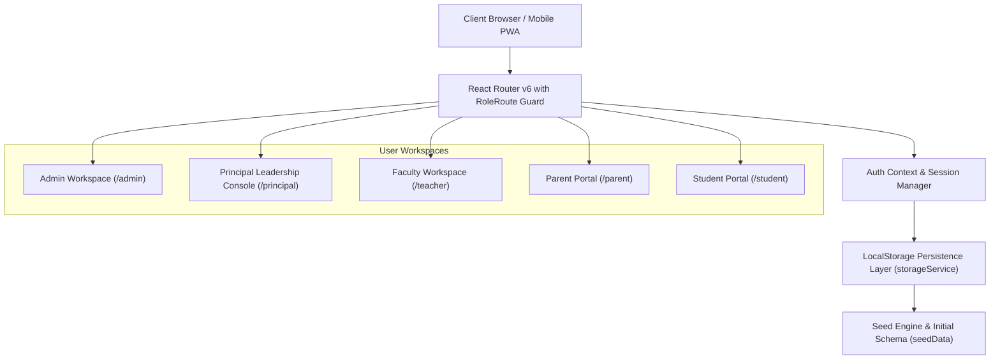
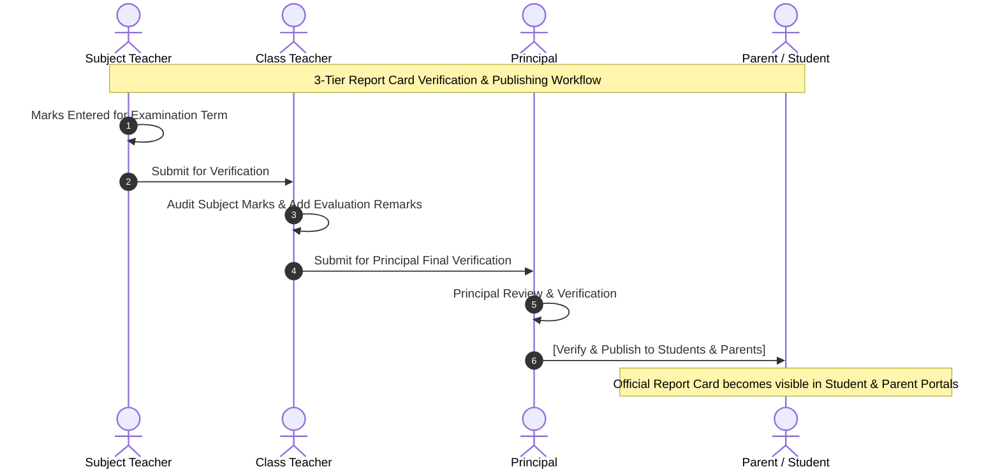
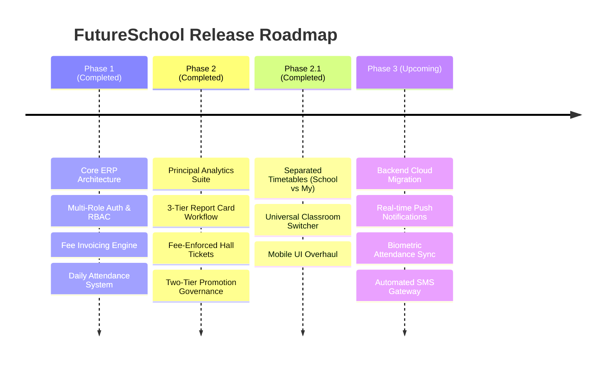

# Product Requirements Document (PRD)
## FutureSchool: Unified K-12 Institutional Management & School ERP System

---

## 1. Executive Summary & Vision

### 1.1 Project Title
**FutureSchool ERP System** (*"One calm place for your whole school."*)

### 1.2 Vision Statement
FutureSchool is a modern, unified, offline-first School Enterprise Resource Planning (ERP) platform designed to eliminate institutional friction across primary and secondary educational institutions. It delivers tailored, role-governed workspaces for **Administrators**, **Principals**, **Faculty Teachers**, **Parents**, and **Students**, ensuring transparency, governance, and rapid operational turnaround without administrative overhead.

### 1.3 Target Audience
1. **School Administration & Bursars**: Manage admissions, staff credentials, fee fee structures, digital receipts, and institutional assets.
2. **School Principals & Academic Directors**: Drive data-backed academic governance through predictive performance analytics, multi-tier approvals (promotions, fee-linked hall tickets), and report card publishing.
3. **Faculty & Class Teachers**: Handle classroom rosters, period-wise attendance, curriculum delivery, assignment evaluations, quiz generation, and parent communications.
4. **Parents & Guardians**: Monitor academic trajectory, clear tuition balances via online transactions, track student transport, and file helpdesk grievances with seamless multi-child switching.
5. **Enrolled Students**: Submit digital homework, take self-evaluative quizzes, download verified examination hall tickets, access library materials, and review official transcripts.

---

## 2. Technical Stack & System Architecture

### 2.1 Technology Stack
* **Framework**: React 18 with TypeScript
* **Build System & Dev Server**: Vite 6
* **Routing**: React Router v6 with custom `<RoleRoute>` guards
* **Styling**: Vanilla CSS Design System with scoped variables (`global.css`), CSS grid, responsive tables (`.table-responsive`), and mobile-first drawer / bottom tab navigation
* **State & Persistence**: Offline-first client persistence engine (`storageService.ts`) backed by `localStorage` with automated schema hydration from `seedData.ts`
* **Icons & Components**: Native scalable SVG components, modular badge elements, KaTeX math rendering, and responsive stat cards

### 2.2 Security & Access Control (RBAC)
* **Standardized Login ID Prefixes**:
  * `ADMxxxx`: School Administration
  * `PRNxxxx`: School Principal
  * `TCHxxxx`: Faculty & Teachers
  * `PARxxxx`: Parents & Guardians
  * `STUxxxx`: Enrolled Students
* **Route Guarding**: All endpoints are protected by `<RoleRoute allowedRoles={[...]}>`. Direct URL tampering automatically redirects unauthorized callers to their respective workspace start pages.
* **Separation of Concerns**: Operational inputs (daily attendance, raw marks entry, quiz creation) are strictly isolated to Teachers. Strategic oversight, approvals, and official publishing belong strictly to the Principal and Administration.

---

## 3. User Personas & Role Specifications

| Persona | Core Objectives | Primary Interfaces & Tools |
| :--- | :--- | :--- |
| **School Administrator** | Institutional continuity, user lifecycle, fee collection & billing audit, transport coordination | Admissions, Student/Staff Rosters, Fee Invoices, Defaulters Register, Routes & Bus Stops |
| **Principal** | Academic excellence, staff workload oversight, institutional approvals, grievance resolution, official report card release | Executive KPI Console, Attendance/Academic Analytics, Hall Ticket Clearance, Promotions, Separated Timetables |
| **Faculty / Class Teacher** | Classroom management, daily attendance, subject coursework delivery, marks verification & evaluation remarks | Classroom Roster, Daily Register, Homework Manager, Marks Gradebook, AI Lesson Planner & Question Paper Gen |
| **Parent / Guardian** | Oversight of ward's progress, transparent fee dues clearance, school messaging, bus tracking | Multi-Child Switcher, Fee Invoices & Payment Portal, Academic Dossier, Bus Locator, Grievance Helpdesk |
| **Student** | Self-directed learning, assignment completion, examination admittance, resource borrowing | Homework Submissions, Online Quizzes, Official Admit Cards, Digital Library, Academic Transcripts |

---

## 4. Detailed Functional Modules & Workflows

### 4.1 Principal Leadership Console & Executive Analytics
1. **Executive Dashboard (`/principal`)**:
   * Institutional KPIs: Enrolled Student Count, Faculty Size, School Attendance Rate, Fee Realization Percentage.
   * Class Academic Leaderboard (ranked by published marks average).
   * Remedial Watchlist: Highlights students scoring below institutional pass threshold ($< 35\%$).
   * Faculty operational workload matrix (non-evaluative distribution across departments).
2. **Dedicated Academic Analytics**:
   * **School Performance (`/principal/school-performance`)**: Departmental performance, workload metrics, and historical trend lines.
   * **Attendance Insights (`/principal/attendance-insights`)**: Chronic absenteeism watchlist ($< 75\%$), morning vs. afternoon session stability.
   * **Academic Performance (`/principal/academic-performance`)**: Grade distribution curve ($A+, A, B, C, F$), subject benchmarks, and remedial intervention roster.
   * **Class Leaderboard (`/principal/class-leaderboard`)**: Gold/Silver/Bronze podium ranking of top sections.
   * **Student Leaderboard (`/principal/student-leaderboard`)**: School-wide scholar ranking, medal podium, and merit register.
3. **Two-Tier Promotion Governance (`/principal/promotions`)**:
   * *Drafting Tier*: Admin compiles prospective promotion batches specifying current class, destination class, academic year transition, and student checklist.
   * *Approval Tier*: Principal reviews pending proposals with one-click **[Accept & Execute Promotion Request]** or **[Reject Proposal]**, transitioning students while preserving complete historical records.
4. **Examination Hall Ticket Clearance (`/principal/hall-tickets`)**:
   * 4 KPI Stat Cards: Total Enrolled, Approved & Released, Pending Approval, Blocked by Fee Dues.
   * **Strict Fee Enforcement**: Students with outstanding dues ($> ₹0$) are locked from approval.
   * Quick-actions: **[Approve All Fee-Cleared Students]**, **[Send Fee Reminder to Parent]**, and class-level filters.
5. **Separated Timetables**:
   * **School Timetable (`/principal/school-timetable`)**: Class-by-class 5-day academic master schedule with classroom switcher.
   * **My Timetable (`/principal/my-timetable`)**: Dedicated personal teaching schedule, period allocations, and faculty duty inspector.

---

### 4.2 Administration & Operations
1. **Student Admissions & Directory (`/admin/students`, `/admin/admissions`)**:
   * Multi-field registration: Student bio, emergency guardian contact, blood group, admission number, roll, and class allocation.
2. **Classrooms & Faculty Subject Allocations (`/admin/classes`)**:
   * Classroom structure setup: Grade, section, division, and designated class teacher.
   * Subject allocation matrix: Assign faculty to specific subjects and sections.
3. **Financial Accounting & Fee Defaulters (`/admin/fees`, `/admin/payments`, `/admin/defaulters`)**:
   * Category-based invoicing (Term Tuition, Laboratory Fees, Transport, Examination).
   * Defaulter watchlist tracking cumulative balances and overdue days.
4. **Transport Fleet Logistics (`/admin/transport`)**:
   * Route codes, assigned vehicles, drivers, coordinator contacts, and sequential bus stops with morning pickup and evening drop timings.

---

### 4.3 Faculty & Classroom Management
1. **Classroom Roster (`/teacher/students`, `/principal/my-classes`)**:
   * Live roll register, admission code, parent mobile contact, and real-time attendance percentage.
   * Dropdown classroom switcher allowing inspection across classes.
2. **Period Attendance Entry (`/teacher/attendance`)**:
   * Date and session picker (Full Day, Morning, Afternoon).
   * One-click bulk toggles (Mark All Present, Mark All Absent) with individual override flags.
3. **Marks Gradebook (`/teacher/marks`)**:
   * Exam term selector (Unit 1, Unit 2, Quarterly, Half Yearly).
   * Grade auto-calculation based on entered percentage scores.
   * Status progression: `Draft` $\rightarrow$ `Submitted For Verification` $\rightarrow$ `Verified` $\rightarrow$ `Published`.
4. **AI Instructional Tools (`/teacher/lesson-planner`, `/teacher/question-paper`)**:
   * AI Lesson Planner generating structured pedagogical plans by grade, subject, and topic.
   * Automated Question Paper Generator creating balanced cognitive question sets (Recall, Application, Analysis).

---

### 4.4 Parent & Student Portals
1. **Multi-Child Switcher (Parent Portal)**:
   * Parents with multiple wards can toggle children via a persistent top banner, instantly refreshing all attendance, fee, homework, and report cards.
2. **Fee Invoicing & Payment Gateway Simulator**:
   * Instant invoice breakdown with balance tracking.
   * Integrated mock checkout generating verified digital payment receipts stored in transaction history.
3. **Homework Submissions & Interactive Quizzes**:
   * Students view instructions, attachments, and due dates with online submission capabilities.
   * Interactive self-grading quizzes with immediate score calculation and review feedback.
4. **Examination Hall Ticket Admittance**:
   * Downloadable, print-ready admit card with school crest, student photo placeholder, and barcode clearance.
   * Locked automatically with explanatory notice if fee arrears exist.

---

## 5. Non-Functional & Quality Requirements

| Dimension | Standard | Implementation Strategy |
| :--- | :--- | :--- |
| **Performance** | Sub-100ms UI transitions, < 1s cold reload | Vite-bundled ES modules, in-memory React state, optimized local storage caching |
| **Mobile Responsiveness** | Flawless viewports down to 320px width | Responsive drawer navigation, bottom tab bar (`.mobile-bottom-nav`), horizontally scrolling data tables (`.table-responsive`) |
| **Data Integrity** | Zero data corruption on browser reload | Synchronous `localStorage` persistence layer with robust JSON parsing fallbacks |
| **Accessibility (a11y)** | WCAG 2.1 AA Compliant | Semantic HTML tags, aria-labels for icon buttons, high-contrast badges, keyboard focus rings |
| **Printability** | Clean paper reports and admit cards | `@media print` CSS rules hiding navigation drawers, headers, and buttons for clean A4 printing |

---

## 6. Implementation Milestones & Completed Releases

### Phase 1: Core Institutional Foundations (Completed)
* Multi-role authentication with standardized login IDs (`ADM`, `PRN`, `TCH`, `PAR`, `STU`).
* Comprehensive fee collection, invoice generator, and payment history ledger.
* Teacher marks gradebook, student roster, homework broadcasting, and attendance entry.
* Parent multi-child switching mechanism and student homework dashboard.

### Phase 2: Principal Executive Governance & Oversight (Completed)
* Dedicated analytics suite (School Performance, Attendance Insights, Academic Performance, Class & Student Leaderboards).
* Fee-cleared Hall Ticket issuance with payment reminder triggers.
* Two-tier promotion proposal and execution workflow.
* Institutional grievance helpdesk with priority escalation routing.
* 3-tier report card publishing pipeline with Principal verification seal.

### Phase 2.1: Navigation & Schedule Specialization (Completed)
* Separated **School Timetable** (`/principal/school-timetable`) from **My Timetable** (`/principal/my-timetable`).
* Re-engineered **Classroom Rosters** (`/principal/my-classes`) with dynamic class switching and search.
* Mobile-first responsive overhaul (bottom tab bar, compact headers, scrollable tables).

---

## 7. Future Horizons (Phase 3 Roadmap)

1. **Backend Integration**: Replace browser `localStorage` with a secure RESTful / GraphQL API backed by PostgreSQL and Redis.
2. **Push Notifications & SMS Gateway**: Automated WhatsApp / SMS alerts to parents for unexcused attendance absences, overdue fees, and emergency school bulletins.
3. **Biometric & RFID Bus Integration**: Live GPS bus telemetry on parent maps and biometric thumbprint / smartcard attendance at school gates.
4. **Advanced AI Tutor & Marking Assistant**: Intelligent grading suggestions for descriptive assignments and personalized learning paths for struggling students.
